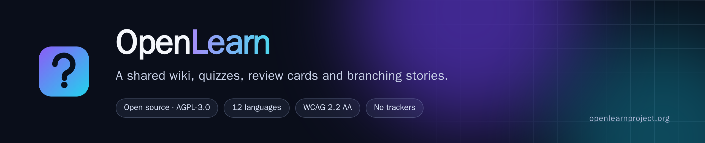
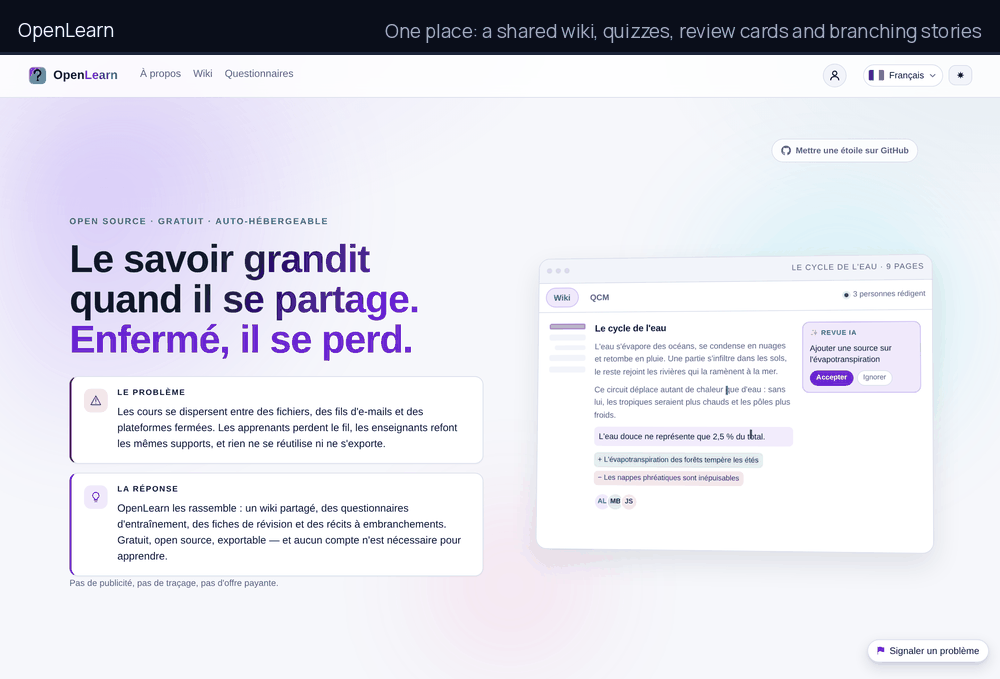

[](https://openlearnproject.org)

[](https://github.com/codeyourweb/openlearn/actions/workflows/ci.yml)


[](https://openlearnproject.org)

> **Live demo: <https://openlearnproject.org/>** — a seed catalogue of wikis,
> questionnaires and adventures, in twelve languages, no account needed to read.
> Sign up to write; the instance is reset from time to time.
>
> **Documentation site: <https://codeyourweb.github.io/openlearn/>** — what the
> product does, the philosophy behind it, and a user guide that walks through
> every screen.

**Knowledge grows when it is shared.** Courses scatter across files, e-mail
threads and closed platforms: learners lose the thread, teachers rebuild the same
slides, and nothing can be reused or exported. OpenLearn puts it back in one
place — a shared wiki, self-training questionnaires, revision cards and
branching stories — free, open source and self-hostable, with no account needed
to learn.

- **Free, forever.** No ads, no tracking, no paid tier, no feature held back.
- **Runs anywhere.** One container, or one Python process, against SQLite,
  PostgreSQL or MariaDB. No build step, no CDN, no external service required.
- **Your data leaves with you.** Every page exports as Markdown, every wiki as a
  zip, every quiz through the API. Nothing is locked in a vendor.
- **Built for distance learning.** Live sessions with a PIN, self-paced
  questionnaires, revision decks, branching adventures, and an interface that
  holds up on a phone and on a slow link.
- **AI is optional.** When no model is configured, every AI control disappears
  from the interface; when one is, the administrator chooses it and users cannot
  spend a quota by accident.

Two ways in: a Kahoot-style live session — someone hosts, the room answers, a
scoreboard appears — and a wiki where a class, a team or a community writes what
it knows. Both live behind the same account and the same REST API.

> **Independence.** "OpenLearn" is also the name of a free-learning site run by
> The Open University (UK). This project is independent: different code,
> different maintainers, no connection and no endorsement. The domain carries a
> qualifier (`openlearnproject.org`) so the two are not mistaken for each other.


## Table of contents

1. [Feature overview](#feature-overview)
2. [Architecture](#architecture)
3. [Quick start](#quick-start)
4. [Configuration](#configuration)
5. [Demo mode](#demo-mode)
6. [Administration](#administration)
7. [Game rules](#game-rules)
8. [Testing](#testing)
9. [Deployment](#deployment)
10. [Project layout](#project-layout)
11. [Documentation](#documentation)

## Feature overview

| Area | What it does |
| --- | --- |
| Accounts | Email + password registration (8 characters minimum, one uppercase, one lowercase, one digit or symbol), Argon2id hashes, login, logout, display name, password change, personal API keys. |
| Timers | A quiz runs its questions on a per-question clock, on one budget for the whole run, or with no clock at all — in which case the per-question field disappears from the editor and the play screen shows "no time limit" instead of counting down; a story can add its own scene clock that costs an attribute penalty or an early death when it runs out. |
| Formats | Creating a quiz starts on a chooser with four cards — multiple choice, swipe cards, poll, adventure. Picking one opens a second step that asks how to fill it: a model-generated first draft to edit, or a blank form. Multiple choice, swipe and poll stay interchangeable afterwards; the adventure card opens the story canvas directly. |
| Quiz authoring | Create, edit, duplicate and delete quizzes; public or private; 1-200 questions; 2-8 answers per question; WYSIWYG text sanitised server side; optional image upload (2 MB, PNG/JPEG/WEBP/GIF, re-encoded) with a progress bar, and an image preview for story scenes. Every edit is autosaved as a draft, so a closed tab loses nothing. AI actions show a blocking overlay instead of leaving the page looking frozen. |
| Versioning | Publishing freezes an immutable snapshot. Authors keep editing the working copy without unpublishing, moderators approve the new version while the last approved one keeps serving visitors, and any earlier version can be restored — and republished — in one click. |
| Answer mode | A question with a single correct answer renders as radio buttons, a question with several correct answers renders as checkboxes — the client is told by the server, never by guessing. |
| Sessions | Solo practice (start immediately) or live lobby with PIN and share link, launched from the quiz page or straight from its card in the catalogue; host controls start, reveal, next, cancel and finish; the host can also enrol as a player and answer alongside the room; participants reconnect with their token. |
| Scoring | Per-question points (default 100), exact-set matching for multi-answer questions, `zero` or `penalty` policy for wrong answers. |
| Polls | A poll is a quiz without an answer key: no row is correct, nothing is scored, and the respondent only sees that their answer was recorded. Questions accept one or several choices, the timer runs per question or across the whole run, and the author decides who may read the distribution — themselves only, respondents too, or anyone. The quiz page shows it as a bar chart built from `/quizzes/{id}/results`. |
| History | Every account keeps a participation log — sessions played and hosted, score, rank among human players, mode and player count — reachable from the profile and linking to the full result detail. |
| Creator statistics | The quiz page exposes per-question analytics to its owner: how many players answered, how many got it right and the success rate per question, aggregated across every session of that quiz. |
| Interface | Twelve interface languages — French, English, Italian, Spanish, German, Portuguese, Russian, Simplified Chinese, Japanese, Hindi, Bengali and Arabic — picked from a flag menu in the header or from the profile. Every key is translated in every language, and Arabic switches the whole document to right-to-left. Light/dark theme; everything switches at runtime without a reload. Responsive layout that uses the full width on large screens (editors, story canvas, host and play views), and a paginated catalogue of ten quizzes per page. |
| Quiz modes | `qcm` (answer grid), `swipe` (one statement per card: drag right for yes, left for no, arrow keys as the keyboard equivalent) or `poll` (no right answer). |
| Publication | Draft → private → pending → public, per version. Authors choose between publishing privately (frozen, playable and shareable by link, out of the catalogue) and publishing publicly; ordinary authors who ask for the catalogue are queued for moderation and told so, and their quiz stays usable privately meanwhile. Administrators and trusted authors go live at once; the AI safety review can block a quiz. |
| Story editor | Adventure graphs edited on a canvas that mirrors a workflow editor: every block lists its answers as numbered rows, each row owns the output port on its right edge, and a link is drawn by dragging that port — or the answer itself — onto the next block. Hovering an answer highlights its link; scenes are laid out in columns with a "Tidy up" button; adding, deleting and right-clicking a scene all work from the canvas, and the whole thing autosaves. A floating toolbar in the workspace carries the canvas controls (add a scene, add an ending, duplicate, delete, tidy up, fit, zoom) instead of a panel of buttons; dragging empty space pans the graph, and the zoom buttons keep the middle of the view in place. Below 900 px the canvas and the inspector stack vertically with the graph full width and its own touch-friendly bar. |
| Legal notice | A `/legal` page made of two layers: the project's own notice (publisher, licence, contribution rules, personal data), translated with the interface, and the notice an administrator adds for their server — publisher, host, contact, retention — written in markdown, one document per language, in a rich editor limited to the wiki formatting subset. Optional AI translation per language, reviewed before saving. |
| AI assistance | Optional: generate a quiz from a topic, translate a quiz, safety-review its content, fact-check its answer key and apply the corrections. Translation sits inside each question form — the secondary-language block is expanded by default and a per-question button fills it — so the author never leaves the question they are writing. One AI call per account every 15 seconds, and a document that has not changed since its last translation is served from the database instead of being paid for twice. |
| Wiki | Markdown knowledge bases next to the questionnaires: one wiki holds pages, each page keeps every version with author, note and a side-by-side diff — removed lines red on the left, added lines green on the right, changed words highlighted, `[[links]]` between pages become internal links with backlinks and a link graph, and a canvas lets you arrange cards freely. Writing offers three modes — WYSIWYG, Markdown or a read-only preview — on one full-width surface, with autosaved drafts, image upload and Ctrl+S. Owners invite maintainers (they publish) and contributors (their edits wait as suggestions); anybody with read access can suggest an update. Export a page as `.md` or a whole wiki as a zip with links rewritten, and import the other way: a zip exported by Obsidian (vault) or Joplin (notebook) becomes a wiki — front matter, `[[wikilinks]]`, attachments and folder titles preserved — while a single `.md` file becomes a page; every imported archive is treated as hostile (bounded size, entry count, page count, normalised paths, images re-encoded through Pillow). A page opens on a live socket shared by everybody allowed to write: each editor sees who else is on the page and where their caret sits, and typed text reaches the others in under a second — the server merges the two texts and broadcasts one splice, so two people never overwrite each other; images can be dropped (or pasted) straight into the WYSIWYG or the markdown surface. The menu is a real tree: pages nest under a parent, the page you are reading is marked in it and in the breadcrumb, and a dedicated screen reorders and re-parents the whole menu by drag and drop (arrow buttons for the keyboard). A writer can delete the page being shown, and the owner can erase the whole wiki — its pages climb one level rather than vanishing with their parent, and everything attached (versions, links, citations, proposals) goes with them. Templates are skeletons written inside a wiki and reusable by every contributor of that wiki: a new page can start from one, and applying a template only fills the editor until the author saves. Pictures inserted in the editor can be sized from the rich view — a floating strip (25/50/75/100 %) or a drag handle — and the width travels in the markdown as `{width=320}`. "Link a page" opens a search box rather than a prompt: it lists this wiki's pages, then searches by full text, and can reach pages of other public wikis. References are first-class: each page can cite external sources and internal pages, links written as `[[slug]]` or `https://…` are indexed automatically, and the reference screen lists every source with the pages using it, every internal link, the `[[links]]` that point nowhere yet (one click creates the page) and the orphan pages nothing links to. |
| Wiki AI | AI works at two levels. On a page, "Write this page with AI" takes the same kind of paragraph — angle, depth, examples to use and to avoid — and drops the written body straight into the editor open in front of you: nothing is stored, you cut and rewrite before saving; the spelling, editorial and compliance reviews sit at the top of the editing area, next to the mode switch. Creating several pages belongs to the wiki itself: writers get a "Generate pages" panel with the brief, the style, the audience and the page count, and the job plans the outline, researches the web through SearXNG and writes each page with numbered footnotes pointing at the sources it actually used. The chat answers questions from the wikis the reader may open, always citing the extracts it used, in the language of the interface. One job at a time per topic, 15 seconds between calls. |
| Catalogue naming | The quiz section is called **Questionnaires** everywhere — five formats behind one word: live quiz, self-paced QCM, swipe cards, branching adventure and poll. The "About" page explains the platform and doubles as the public landing page. |
| Moderation | `/admin` page and `/admin/*` API: queue, accounts, roles, AI reviews and the security audit log. Wikis queue in their own tab; staff also write everywhere as maintainers, so a typo can be fixed without filing a proposal against themselves. Three roles above *member*: **trusted** (publishes without prior moderation), **moderator** (validates content and vouches for members, no access to the instance configuration) and **administrator** (everything). |
| Search | Full-text search over titles and descriptions (SQLite FTS5, falling back to `LIKE` when the extension is absent). |
| Interoperability | The entire UI is a client of `/api/v1`; API keys and JWTs allow third-party clients. |
| Operations | Docker image running as a non-root user with a read-only root filesystem, or a plain `run.sh` for bare-metal self-hosting. SQLite by default, with a boot-time sweep that removes rows orphaned by an earlier raw delete — a recycled SQLite id would otherwise hand a new quiz the answer key of a deleted one. |

## Architecture

```
                    ┌───────────────────────────────────────────┐
  browser / app ───▶│  FastAPI (uvicorn, 1 worker)              │
                    │                                           │
                    │  routers/  auth users quizzes sessions    │
                    │            uploads                        │
                    │  game.py   session engine + timers        │
                    │  scoring.py  answer evaluation            │
                    │  sanitize.py  HTML allowlist (nh3)        │
                    │  realtime.py  WebSocket rooms             │
                    └───────────────┬───────────────────────────┘
                                    │ SQLAlchemy 2
                            ┌───────▼────────┐      ┌──────────────┐
                            │ SQLite (WAL)   │      │ media/ (webp)│
                            └────────────────┘      └──────────────┘
```

The frontend is a dependency-free single-page application (ES modules, History
API router, no build step) served by the same FastAPI process, which keeps the
deployment to one container and one volume.

Two design decisions drive the rest of the code:

- **Sessions snapshot the quiz.** When a session is created, its questions and
  options are copied into `session_questions` / `session_options`. Editing or
  deleting the source quiz never corrupts a live or archived session.
- **The server is the only judge.** Correct answers are never sent to a player
  before the reveal phase, answers are validated against the snapshot, and
  points are computed server side.

## Quick start

### Docker (recommended)

```bash
git clone https://github.com/codeyourweb/openlearn.git
cd openlearn
cp .env.example .env          # set OL_ADMIN_EMAIL / OL_ADMIN_PASSWORD
docker compose up -d
```

The app answers on <http://localhost:8000>. Data lives in the `openlearn-data`
volume: SQLite database, uploaded images, signing key. The container runs as
uid 10001, with a read-only root filesystem and every capability dropped.

A database server is one overlay away:

```bash
# PostgreSQL
docker compose -f docker-compose.yml -f docker-compose.postgres.yml up -d
# MariaDB / MySQL
docker compose -f docker-compose.yml -f docker-compose.mysql.yml up -d
# TLS held by the application itself, no reverse proxy
docker compose -f docker-compose.yml -f docker-compose.tls.yml up -d
```

A managed database works the same way: keep the app alone and point
`OL_DATABASE_URL` at it.

### Without Docker

```bash
./run.sh                      # http://0.0.0.0:8000
PORT=8080 ./run.sh           # custom port
./run.sh --reload             # development mode
```

`run.sh` creates a virtual environment, installs `backend/requirements.txt`,
generates a signing key in `data/.secret_key` and hands over to `serve.sh`, which
also serves HTTPS directly when `OL_TLS_CERT_FILE` and `OL_TLS_KEY_FILE` are set.

## Configuration

Every setting is an environment variable prefixed with `OL_`; the administration
panel can override most of them at runtime, and the database then wins over the
environment. The full list lives in `backend/app/config.py`.

| Variable | Default | Purpose |
| --- | --- | --- |
| `OL_ENVIRONMENT` | `production` | Free-form label; `production` keeps interactive docs disabled. |
| `OL_DEBUG` | `false` | Verbose errors. Never enable on a public instance. |
| `OL_DATABASE_URL` | `sqlite:///data/openlearn.db` | Any SQLAlchemy URL: SQLite, `postgresql+psycopg`, `mysql+pymysql`. |
| `OL_MEDIA_DIR` | `data/media` | Where uploaded images are stored. |
| `OL_SECRET_KEY` | generated | Token and SSO-state signing key. Generated once into `data/.secret_key` when unset; must be shared by replicas. |
| `OL_ACCESS_TOKEN_TTL_MINUTES` | `720` | Session/token lifetime. |
| `OL_COOKIE_SECURE` | `false` | Force the `Secure` flag. Applied automatically over TLS through a proxy (`X-Forwarded-Proto: https`). |
| `OL_COOKIE_DOMAIN` | unset | Cookie domain for sub-domain deployments. |
| `OL_PUBLIC_BASE_URL` | unset | Base URL for share links, reset e-mails and SSO callbacks (`https://learn.example.org`). Derived from the request when empty. |
| `OL_INSTANCE_NAME` | `OpenLearn` | Header, page title and e-mail signature. |
| `OL_GITHUB_URL` | project repository | Target of the "star on GitHub" link on the presentation page. |
| `OL_MAX_UPLOAD_BYTES` | `2097152` | Upload limit (2 MB). |
| `OL_MAX_QUESTIONS_PER_QUIZ` | `200` | Hard cap. |
| `OL_MAX_PARTICIPANTS_PER_SESSION` | `500` | Hard cap. |
| `OL_AUTH_RATE_LIMIT` / `OL_AUTH_RATE_WINDOW_SECONDS` | `10` / `60` | Login, registration and token requests per IP. |
| `OL_JOIN_RATE_LIMIT` / `OL_JOIN_RATE_WINDOW_SECONDS` | `30` / `60` | Session joins per IP. |
| `OL_SEED_DEMO_DATA` | `true` | Creates the demo account and the sample quiz on first start. |
| `OL_DEMO_MODE` | `false` | Loads the demo catalogue and shows the presentation page as the entry screen. |
| `OL_DEMO_PASSWORD` | `DemoPassw0rd!` | Password of the demo accounts. Change it, or set `OL_SEED_DEMO_DATA=false`. |
| `OL_ADMIN_EMAIL` / `OL_ADMIN_PASSWORD` | unset | Bootstrap administrator, created or promoted at start-up. |
| `OL_AI_ENABLED` | `false` | Turns the AI features on. When off, their controls are hidden from the interface. |
| `OL_AI_BASE_URL` | unset | OpenAI-compatible endpoint (`http://ollama:11434/v1`). |
| `OL_AI_API_KEY` | unset | Key for that endpoint. |
| `OL_AI_MODEL` | unset | Model for quiz and adventure generation. |
| `OL_AI_WIKI_MODEL` | inherits `OL_AI_MODEL` | Smaller model for wiki style passes. |
| `OL_AI_TIMEOUT_SECONDS` | `180` | Per-call timeout. |
| `OL_AI_MIN_INTERVAL_SECONDS` | `15` | Throttle between two AI calls for one user; `0` disables it. |
| `OL_MAIL_ENABLED` | `false` | Enables SMTP (password resets). |
| `OL_MAIL_HOST` / `OL_MAIL_PORT` | unset / `587` | SMTP server. |
| `OL_MAIL_USERNAME` / `OL_MAIL_PASSWORD` | unset | SMTP credentials. |
| `OL_MAIL_FROM_ADDRESS` / `OL_MAIL_FROM_NAME` | unset | Sender identity. |
| `OL_SSO_ENABLED` | `true` | Allows OIDC/SAML providers declared in the administration panel. |
| `OL_MCP_ENABLED` / `OL_MCP_REQUIRE_AUTH` | `true` / `true` | Agent endpoint, see [docs/MCP.md](docs/MCP.md). |
| `OL_TLS_CERT_FILE` / `OL_TLS_KEY_FILE` / `OL_TLS_PORT` | unset / unset / `8443` | Serve HTTPS directly. |
| `OL_SEARCH_BASE_URL` | unset | Optional SearXNG endpoint handed to the model for fact-checking. |

## Demo mode

`OL_DEMO_MODE=true` turns an instance into a showcase, and changes nothing in
the code:

- the catalogue under `demo/content/*.json` is loaded once at boot — wikis,
  questionnaires, revision decks and adventures, mostly in English, with French,
  German, Spanish and Italian entries as well;
- the entry screen becomes the presentation page (problem, answer, what is
  inside) and the *About* link appears in the header; on a private instance the
  entry screen is the wiki listing instead;
- demo accounts share `OL_DEMO_PASSWORD`; set it before exposing the instance.

```bash
# Seed an existing database without restarting
OL_DEMO_MODE=true python -m app.demo.seed
```

Content is data, not code: a private instance never reads it, and editing a file
changes a fingerprint stored in `app_settings`, so the next boot imports the new
version. The loader never overwrites what a real person wrote.

The demo content is not part of the application: it is what a public demo shows,
and it can be removed by dropping the volume.

## Game rules

- A question is correct only when the selected set is **exactly** the set of
  correct options: selecting one of two correct answers is wrong, and so is
  selecting the right answers plus a wrong one.
- Points are awarded per question (`points`, default 100).
- With `wrong_answer_policy = "zero"`, a wrong answer scores 0.
- With `wrong_answer_policy = "penalty"`, a wrong answer subtracts the question
  points and the total can go negative.
- No answer (timeout) always scores 0, even with the penalty policy.
- The session ends when the host finishes it, or automatically after the last
  question is revealed.
- `timer_mode = "per_question"` gives every question its own clock;
  `"global"` shares one budget for the whole run, fixed when the first question
  starts, and ignores the per-question limits; `"none"` removes the clock and
  lets players answer at their own pace. The setting is copied into the session
  when it is created, so editing a quiz never moves a clock mid-game.
- A story can add a scene clock (`none`, `global`, `per_node`). The deadline
  lives on the server; when it passes, the scene costs an attribute penalty or
  ends the run early, and the player cannot trigger the expiry before then
  (`POST /api/v1/adventure/runs/{token}/timeout` answers `409`).

## Testing

```bash
# Backend: API, session engine, scoring, OWASP-oriented security tests
.venv/bin/python -m pytest tests -q --ignore=tests/test_frontend_e2e.py

# Frontend end-to-end (Playwright) against a running instance
OL_TEST_BASE_URL=http://localhost:8080 .venv/bin/python -m pytest tests/test_frontend_e2e.py -q

# Everything inside Docker (builds a Playwright image, runs against the app container)
docker compose -f docker-compose.yml -f docker-compose.dev.yml run --rm tests
```

### What the end-to-end suite expects from its instance

The Playwright scenarios drive a real browser, so they need an instance shaped a
particular way. Pointing them at a plain server fails in ways that look like
frontend bugs but are setup gaps:

- **Demo catalogue seeded, demo mode off.** The scenarios expect public quizzes
  and wikis to exist, yet one scenario asserts that `/` opens the wiki listing
  rather than the presentation page. Seed the catalogue (`tools/demo-seed.sh`)
  and keep `OL_DEMO_MODE` false.
- **AI enabled.** Scenarios check the AI cards and buttons; with AI disabled
  they are hidden and the assertions fail on missing elements.
- **A generous auth rate limit.** The suite registers around twenty accounts
  from one address within minutes, while `OL_AUTH_RATE_LIMIT` defaults to ten
  per minute. Raise it for the test instance, never for a public one.

The suite skips itself when `OL_TEST_BASE_URL` is empty, and skips the
pagination scenario when no admin credentials are supplied.

Current state: the suite covers the API, the game engine, scoring, timers,
versioning, the story graph and the security surface, plus Playwright scenarios
that drive the real UI (registration and authoring, a solo run, a live session
with a guest, the swipe deck, the story editor gestures, the API reference page
and the quiz detail layout). See [SECURITY.md](SECURITY.md) for the OWASP
traceability matrix.

## Administration

An administrator configures the instance from `/admin`:

- **Model provider** — endpoint, key, model, timeout, throttle between two
  calls; a "test the connection" button and a log of every failed call.
- **E-mail** — SMTP credentials, sender identity, "send a test message".
- **Registration and security** — open or closed registration, lifetime of a
  password-reset link.
- **Single sign-on** — any number of OIDC providers (Entra ID, Okta, Keycloak,
  Google…) or SAML 2.0 service providers, added from the panel without a
  redeploy. The provider authenticates; the account and its roles stay local.
- **AI error log** — what the model provider answered when it failed. Users only
  ever see "the AI features are temporarily unavailable".

Settings are stored in the database and take precedence over the environment,
so an instance can be reconfigured without a restart. Secrets are write-only:
the API reports whether a value is set, never what it is.

Details in [docs/ADMINISTRATION.md](docs/ADMINISTRATION.md).

## Deployment

OpenLearn runs as one container with SQLite, or against PostgreSQL or MariaDB,
behind a reverse proxy or with TLS terminated by the application itself.

- [docs/DEPLOYMENT.md](docs/DEPLOYMENT.md) — the five deployment shapes,
  environment reference, TLS in both directions, backups, upgrades, scaling.
- [docs/MCP.md](docs/MCP.md) — the Model Context Protocol endpoint that lets an
  external agent read the wikis, with client configuration examples.

Behind a proxy, two headers matter: `Host` and `X-Forwarded-Proto`. With the
latter set to `https`, cookies are flagged `Secure`, HSTS is emitted and share
links are built on the public URL. The proxy must also replace
`X-Forwarded-For` rather than append to it, and the application must be told to
trust it (`FORWARDED_ALLOW_IPS`), otherwise every visitor appears under the
proxy's address and per-address rate limits become global.

### Source of truth

This repository is the only place the code is edited. A server keeps a copy —
`/srv/openlearn` in the reference deployment — built into an image and never
edited by hand: the next deployment replaces it wholesale. One command does the
whole round trip, from a clean or dirty checkout to a running instance:

```bash
tools/deploy.sh              # archive, install, verify both trees, rebuild, restart, wait for health
tools/deploy.sh --no-build   # install only
```

It refuses to build when the file counts differ between the checkout and the
server, so the deployed copy cannot silently drift. Keep infrastructure files
that live outside the repository — compose file, reverse-proxy configuration,
firewall and ban rules — under the operator's own version control; they are not
part of this tree and a deployment does not touch them.

## Project layout

```
backend/app/
  config.py      settings (OL_* environment variables)
  runtime.py     settings editable from the administration panel
  db.py          SQLAlchemy engine, SQLite pragmas
  migrate.py     schema migrations, run in one transaction at boot
  models.py      ORM models incl. session snapshots, settings, SSO providers
  schemas.py     Pydantic request/response models
  security.py    Argon2id, JWT, API keys, rate limiter
  sanitize.py    HTML allowlist shared by editor and renderer
  scoring.py     answer evaluation
  game.py        session engine (lobby, questions, timers, results)
  realtime.py    WebSocket rooms
  ai.py          model client, JSON repair, error logging
  wiki_ai.py     style, grammar and page-generation passes
  mailer.py      SMTP sender used by password resets
  sso.py         OIDC and SAML 2.0 service provider
  mcp.py         read-only MCP server (JSON-RPC over HTTP)
  demo/seed.py   demo catalogue loader
  routers/       auth, sso_auth, account_recovery, users, quizzes, sessions,
                 uploads, wiki, adventure, admin, admin_settings, instance
frontend/
  index.html     SPA shell
  css/           themes, responsive layout, CSP-friendly (no inline styles)
  js/            api client, router, store, instance flags, pages/
demo/content/    demo wikis, questionnaires, decks and stories (JSON)
docs/            MCP, deployment and administration guides
tests/           pytest suites (API, engine, scoring, OWASP, Playwright)
Dockerfile       production image (non-root, healthcheck)
Dockerfile.test  test image (Playwright base + pytest)
serve.sh         HTTP or HTTPS launcher used by the image and by run.sh
run.sh           bare-metal launcher (creates the virtual environment)
```

## Documentation

- **The project site** — <https://codeyourweb.github.io/openlearn/>: what the
  product does, why it is built this way, and a user guide covering every
  screen (account, wiki, quizzes, revision, moderation, API, troubleshooting).
  The sources live in [docs/](docs/) and are published by
  `.github/workflows/pages.yml` on every push to `main`.
- `/docs` — a reference rendered by the application itself, straight from its
  own `/api/openapi.json`. It replaces Swagger UI, which needs inline scripts
  and therefore cannot run under this project's strict CSP; `/api/docs` and
  `/api/redoc` redirect to it.
- [API.md](API.md) — every endpoint, payloads, authentication, WebSocket protocol.
- [SECURITY.md](SECURITY.md) — threat model, controls, OWASP Top 10 mapping, how to run the security tests.
- [docs/DEPLOYMENT.md](docs/DEPLOYMENT.md) — install, databases, TLS, backups, upgrades.
- [docs/ADMINISTRATION.md](docs/ADMINISTRATION.md) — settings, AI provider, mail, SSO, demo mode.
- [docs/MCP.md](docs/MCP.md) — the agent endpoint and its tools.

## Contributing

Pull requests are welcome. The CI runs lint, the full test suite on SQLite,
PostgreSQL and MariaDB, the Playwright scenarios against a built image, and a
container smoke test; a pull request that keeps those green can be merged.

```bash
docker compose -f docker-compose.yml -f docker-compose.dev.yml up -d --build
docker compose -f docker-compose.yml -f docker-compose.dev.yml run --rm tests
```

## License

OpenLearn is released under the **GNU Affero General Public License, version 3
only** (`AGPL-3.0-only`). The full text is in [LICENSE](LICENSE), the notices in
[NOTICE](NOTICE).

In short:

- **Free to use, forever**, for individuals and organisations alike:
  self-hosting, teaching, running a training programme, modifying the code.
- **Improvements come back.** Anyone who offers OpenLearn over a network must
  offer the source of their version, modifications included. That is what stops
  a fork from turning shared work into a private product.
- **Making money is allowed.** The AGPL does not forbid hosting the software
  commercially; it forbids doing it *in secret*. Paid hosting, support,
  integration and training are all fine, as long as the code stays open.
- **The name is not part of the deal.** See [TRADEMARK.md](TRADEMARK.md).

Contributions are accepted under the terms of [CLA.md](CLA.md); see
[CONTRIBUTING.md](CONTRIBUTING.md) for how to run the tests and what is expected
in a pull request.
